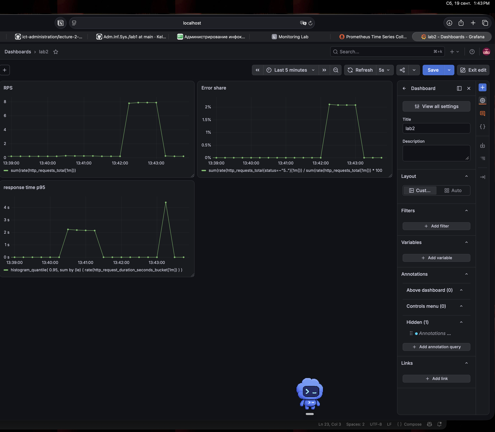
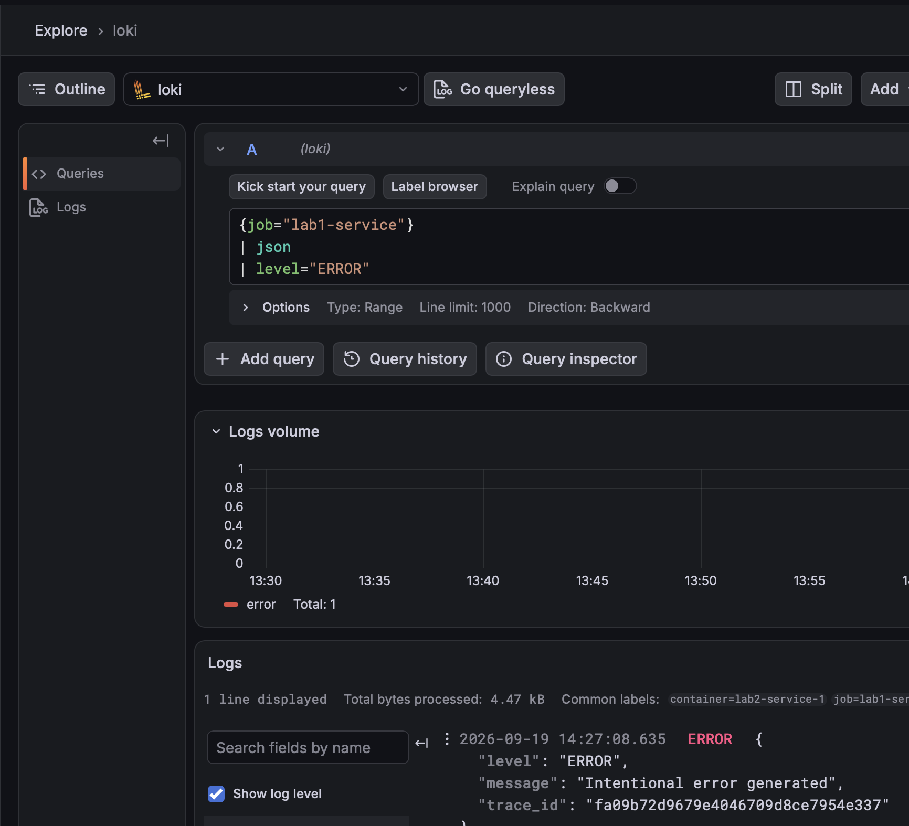

# Lab 2 — Мониторинг приложения: метрики, логи и трассировки
```
by Stephan M
```

В этой работе мы подготовили тестовый сервис на Flask и настроили для него мониторинг. Сервис позволяет создавать ошибки, искусственно увеличивать время ответа и генерировать нагрузку. Для наблюдения используем метрики Prometheus, дашборд Grafana и централизованный сбор логов через Loki и Grafana Alloy. Также добавляем OpenTelemetry, чтобы связывать логи с трассировками запросов.

## Часть 1. Создание сервиса

Сначала разрабатываем небольшой сервис на Python с помощью Flask. На главной странице размещаем три кнопки: `Cause an error`, `Cause a delay` и `Load`.

Кнопка `Cause an error` отправляет запрос, который завершается ошибкой сервера HTTP 500. При этом увеличивается счётчик ошибок, а в лог записывается информация о событии. Эти данные понадобятся для последующего мониторинга.

Кнопка `Cause a delay` имитирует медленный ответ. Запрос завершается успешно с кодом HTTP 200, но перед отправкой ответа сервис ожидает примерно от одной до трёх секунд.

Кнопка `Load` используется для генерации нагрузки. При её нажатии сервис самостоятельно отправляет несколько десятков запросов к endpoint `/work`. За короткое время количество запросов увеличивается, поэтому на графике можно наблюдать рост RPS.

Дополнительно реализуем endpoint `/metrics`, который отдаёт показатели в формате Prometheus. Основные метрики — общее количество запросов, количество ошибок и время выполнения запросов. Для времени ответа используем `histogram`: это позволяет рассчитывать не только среднее значение, но и перцентили, например p95.

Сервис также записывает структурированные логи в JSON. При ошибке в записи указываются уровень события, сообщение и `trace_id`. Такой формат удобен для поиска и фильтрации по отдельным полям, в отличие от обычной текстовой строки.

В приложение добавляем OpenTelemetry. Для каждого HTTP-запроса создаётся trace, а для медленного запроса дополнительно создаётся span `slow-dependency`. При возникновении ошибки span помечается как ошибочный. `trace_id` того же запроса записывается в лог, чтобы впоследствии можно было связать событие с соответствующей трассировкой.

Сервис упаковываем в Docker. В Dockerfile используем Python 3.12, устанавливаем библиотеки из `requirements.txt`, копируем исходный код и запускаем `app.py`. Благодаря этому все зависимости находятся внутри контейнера и не требуют отдельной установки на компьютере.

После сборки контейнера проверяем все три кнопки и endpoint `/metrics`. `Cause an error` увеличивает счётчик ошибок, `Cause a delay` добавляет задержку перед ответом, а `Load` заметно увеличивает количество запросов. На этом этапе сервис готов к подключению инструментов мониторинга.

## Часть 2. Метрики (Prometheus + Grafana)

Для сбора метрик подключаем Prometheus. В отдельном файле `prometheus.yml` указываем интервал сбора — пять секунд.

Для запуска нескольких контейнеров используем `docker-compose.yml`. Сначала через него запускаем сервис и Prometheus, затем добавляем Grafana. Такой подход позволяет управлять всем стендом одной конфигурацией.

После запуска открываем раздел Targets в Prometheus и проверяем, что сервис имеет статус `UP`. Это подтверждает, что Prometheus может получать от него метрики.

Затем проверяем сами показатели через интерфейс Prometheus. После семи нажатий на `Cause an error` значение `http_errors_total` становится равным семи. После нажатия `Load` увеличивается `http_requests_total`.

Далее подключаем Grafana и создаём RED dashboard. Он включает три основных показателя: Rate, Errors и Duration.

- **Rate** показывает скорость поступления запросов — количество запросов в секунду. При генерации нагрузки кнопкой `Load` значение должно увеличиваться.
- **Errors** показывает долю запросов с HTTP-кодами 5xx относительно общего числа запросов. После нескольких нажатий на `Cause an error` доля ошибок увеличивается.
- **Duration** отражает время выполнения запросов. Кнопка `Cause a delay` позволяет увидеть изменение этого показателя.

В процессе проверки заметили особенность сбора метрик. Prometheus обращается к `/metrics` каждые пять секунд, а сервис учитывает этот запрос так же, как остальные HTTP-запросы. Поэтому счётчик запросов постепенно увеличивается даже тогда, когда мы не взаимодействуем с интерфейсом.

В идеале endpoint `/metrics` можно исключить из расчётов RPS и некоторых других показателей, например учитывать только запросы, для которых `endpoint != "/metrics"`. В этой работе оставляем текущее поведение, чтобы было видно, что Prometheus регулярно взаимодействует с приложением.

Также учитываем особенности функции `rate`. Она рассчитывает изменение счётчика за выбранный временной интервал, в нашем случае за последнюю минуту. Если в течение этого периода не возникает новых ошибок, текущий error rate может вернуться к нулю. При этом накопленное значение `http_errors_total` не уменьшается: меняется именно скорость появления новых ошибок.

На рисунке ниже показан RED dashboard после использования всех трёх кнопок. Изменения графиков подтверждают, что метрики поступают в Prometheus и отображаются в Grafana.



### Результат

На этом этапе получаем следующую цепочку:

1. Сервис генерирует данные и отдаёт метрики.
2. Prometheus регулярно собирает и хранит показатели.
3. Grafana получает данные из Prometheus и отображает их на графиках.

Три кнопки позволяют отдельно влиять на основные показатели: `Load` — на Rate, `Cause an error` — на Errors, `Cause a delay` — на Duration.

## Часть 3. Логи (Loki + Alloy → Grafana)

В третьей части настраиваем сбор логов сервиса и их просмотр в Grafana. Для хранения используем Loki, а для сбора — Grafana Alloy. Alloy получает логи Docker-контейнера с приложением и отправляет их в Loki.

Для Loki создаём отдельный конфигурационный файл и запускаем его как контейнер. Затем добавляем Alloy и предоставляем ему доступ к Docker socket, чтобы он мог обнаруживать контейнеры и читать их логи. В конфигурации оставляем только контейнер приложения: логи Prometheus, Grafana и остальных сервисов в Loki не отправляем.

После запуска стека проверяем готовность Loki и состояние Alloy. Затем добавляем Loki в Grafana как отдельный Data Source.

Для проверки открываем Explore в Grafana и несколько раз нажимаем `Cause an error`, чтобы создать новые записи. В Loki появляется JSON-лог с полями `level`, `message` и `trace_id`. Благодаря структурированному формату записи можно фильтровать по отдельным полям, например оставлять только события с `level="ERROR"`.



Отдельно проверяем поиск по сообщению `Intentional error generated`. Это подтверждает, что нужная запись прошла весь путь от приложения до Loki и отображается в Grafana. Полученная цепочка выглядит следующим образом:

1. Сервис записывает лог в stdout.
2. Docker сохраняет вывод контейнера.
3. Alloy получает запись.
4. Loki сохраняет лог.
5. Grafana отображает его и позволяет выполнять поиск.

Важную роль играет `trace_id`: он сохраняется непосредственно в JSON-логе и может использоваться для поиска соответствующей трассировки в Jaeger. Таким образом, в приложении подготовлена связь между логами и traces. Prometheus отвечает за числовые показатели и графики, а Loki — за события и текстовые записи.
