# Lab 3 — Kafka для user-service и picker-service
```
by Artem P
```
Два сервиса обмениваются заказами через Kafka: **user-service** публикует событие «заказ создан», **picker-service** читает его как consumer group и «собирает» заказ. Kafka, топик, сервисы, Kafka UI и мониторинг описаны **декларативно в `docker-compose.yml`** и файлах конфигурации. Любое изменение — это правка конфига и `docker compose up -d`. Kafka UI использовался только для операций, которых нет в конфигурации (поиск сообщения, сброс offset'ов).

## Итог по ситуациям

| # | Проблема | Что изменили | Почему сработало |
|---|---|---|---|
| 1 | Распродажа: нужно делить обработку между несколькими сборщиками | `TOPIC_PARTITIONS: 1 → 3` в `kafka-init` | Партиция — единица параллелизма: в группе каждую партицию читает один консьюмер, поэтому сборщиков может работать не больше, чем партиций. Уменьшить число партиций Kafka не даёт, после пика уменьшается число консьюмеров |
| 2 | Второй сборщик | Сервис `picker-2` в той же группе `pickers` | Группа перераспределила партиции (ребаланс): `[0,1]` и `[2]`. Четвёртый сборщик при трёх партициях простаивает и служит горячим резервом |
| 3 | Сборщики упали во время деплоя | Явные `retention.ms`, `offsets.retention.minutes`, `AUTO_OFFSET_RESET=earliest`; коммит после обработки | Чтение не удаляет сообщения; позиция группы хранится отдельно в `__consumer_offsets`; после рестарта группа продолжает с закоммиченного offset'а |
| 4 | Жалоба на конкретный заказ | — (Kafka UI) | Поиск сообщения по `order_id`; заказ обработан, если его offset меньше Consumer Offset группы в этой партиции |
| 5 | Аналитикам нужна вся история | — (Kafka UI: reset offsets → earliest) | Kafka — лог: сообщения живут до retention, а offset группы — просто число, которое можно переставить |
| 6 | Диск забивается старыми заказами | `retention.ms` 7 дней → 2 дня, `segment.ms` → 1 час | Retention удаляет закрытые сегменты независимо от того, прочитаны ли сообщения; `segment.ms` задаёт, как часто сегменты закрываются |

---

## Архитектура

```
user-service ──produce, key=order_id──▶  Kafka (KRaft, 1 узел)  ──▶  group "pickers": picker-1, picker-2
                                          topic orders × 3
kafka-init   ──создаёт/приводит топик──▶  Kafka
Kafka UI     ──просмотр, reset offsets──▶ Kafka

Kafka ◀──Admin API── kafka-exporter ◀──┐
хост  ◀───────────── node-exporter  ◀──┴── Prometheus (scrape 10s, алерты) ◀──PromQL── Grafana (дашборд)
```
Стрелки показывают, кто к кому обращается: Prometheus сам забирает метрики у экспортеров (pull-модель).

| Компонент | Образ | Адрес |
|---|---|---|
| Kafka (KRaft) | `apache/kafka:3.9.1` | `kafka:9092` в сети, `localhost:9094` с хоста |
| kafka-init | `apache/kafka:3.9.1` | one-shot, завершается с кодом 0 |
| user-service | собирается из `./user-service` | http://localhost:8000 |
| picker-1 / picker-2 | собирается из `./picker-service` | http://localhost:8001, http://localhost:8002 |
| Kafka UI | `provectuslabs/kafka-ui:v0.7.2` | http://localhost:8080 |
| kafka-exporter | `danielqsj/kafka-exporter:v1.9.0` | http://localhost:9308/metrics |
| node-exporter | `prom/node-exporter:v1.12.1` | только внутри сети |
| Prometheus | `prom/prometheus:v3.15.0` | http://localhost:9090 |
| Grafana | `grafana/grafana:13.2.3` | http://localhost:3000 |

Все версии образов зафиксированы явно: тег `latest` при следующем `up` мог бы поднять другую версию.

## Структура репозитория

```
lab3/
├── README.md
├── docker-compose.yml          # весь стенд
├── docker-compose.sale.yml     # снимок конфига на момент ситуаций 1–2: 4 сборщика, retention 7 дней,
│                               # ещё без Kafka UI и мониторинга
├── user-service/               # app.py, Dockerfile, requirements.txt
├── picker-service/             # app.py, Dockerfile, requirements.txt
├── monitoring/
│   ├── prometheus.yml          # что опрашивать + rule_files
│   ├── alerts.yml              # 3 правила алертов
│   ├── alerts.test.yml         # unit-тесты правил (promtool)
│   └── grafana/
│       ├── provisioning/datasources/prometheus.yml
│       ├── provisioning/dashboards/dashboards.yml
│       └── dashboards/kafka-orders.json
└── screenshots/                # 37 скриншотов, пронумерованы по ходу работы
```

## Как запустить

Требования: Linux (проверено на Ubuntu), Docker Engine 24+ с плагином Compose v2, около 4 ГБ свободной памяти.

```bash
docker compose config --services   # проверить конфиг: 10 сервисов
docker compose up -d --build
docker compose ps -a               # kafka (healthy), kafka-init Exited (0), остальные Up
```

Grafana: просмотр без логина (роль Viewer), администратор `admin` / `lab3-admin` (пароль в compose допустим только для локального стенда; в проде он хранится в секретах).

Kafka UI, Prometheus, Grafana и экспортер опубликованы только на `127.0.0.1`: у Kafka UI в этой конфигурации нет авторизации и есть полные права администратора (удаление топиков, сброс offset'ов), поэтому наружу он не выставлен.

**Проверка воспроизводимости.** Весь стенд описан конфигурацией, поэтому поднимается с нуля без ручных действий: `docker compose down -v && docker compose up -d --build` (удаляет данные!) — `kafka-init` создаёт `orders` сразу с 3 партициями и итоговыми retention/segment, Grafana и Prometheus поднимаются с готовым дашбордом и правилами алертов.

---

## Часть 1. Сервисы

Python 3.12, Flask, `confluent-kafka` (librdkafka). У каждого сервиса свой Dockerfile; все параметры передаются через переменные окружения.

| Переменная | user-service | picker-service |
|---|---|---|
| `KAFKA_BOOTSTRAP_SERVERS` | ✓ | ✓ |
| `KAFKA_TOPIC` | ✓ | ✓ |
| `KAFKA_GROUP_ID` | — | ✓ |
| `INSTANCE_NAME` | ✓ | ✓ |
| `PROCESS_SECONDS` | — | ✓ (время «сборки», 2 с) |
| `AUTO_OFFSET_RESET` | — | ✓ (`earliest`) |

Решения в коде, которые важны для Kafka:

- **Ключ сообщения = `order_id`.** Партиция выбирается как `hash(key) % N`, поэтому все события одного заказа попадают в одну партицию и обрабатываются по порядку. Порядок Kafka гарантирует только внутри партиции.
- **Продюсер с `acks=all`.** Брокер подтверждает запись после сохранения на всех in-sync репликах. Partition и offset на странице user-service — это ответ брокера на подтверждённую запись.
- **Консьюмер с `enable.auto.commit=false`.** Offset коммитится только **после** сборки заказа, это гарантия at-least-once (подробнее в ситуации 3).
- **`topic.metadata.refresh.interval.ms=10000`.** Клиенты перечитывают метаданные раз в 10 секунд вместо 5 минут, поэтому новые партиции подхватываются быстро.
- Страница сборщика показывает назначенные партиции, журнал ребалансов и собранные заказы (partition, offset, инстанс).

**user-service:** 10 заказов, записанных за одну секунду, — у каждого partition и offset из подтверждения брокера.

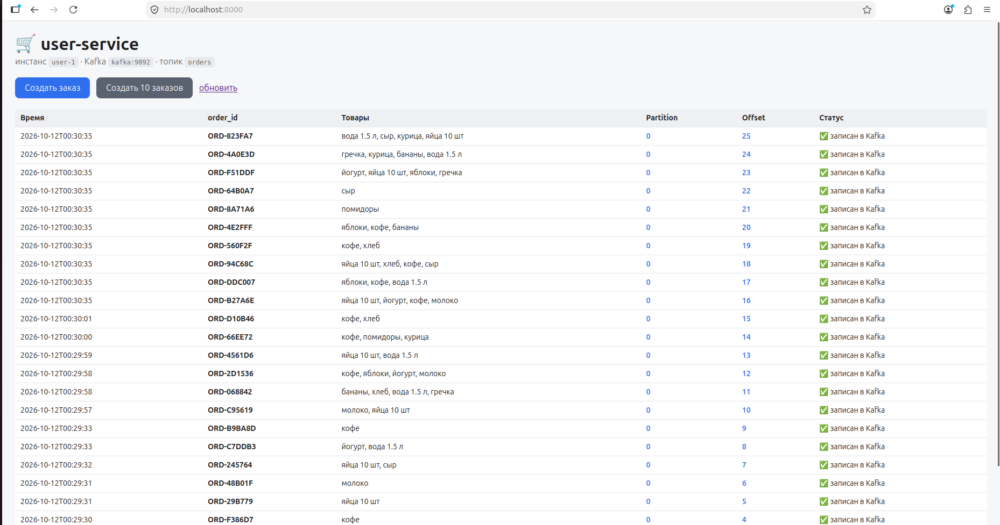

**picker-1:** назначенная партиция, журнал группы, собранные заказы — по одному каждые 2 секунды.

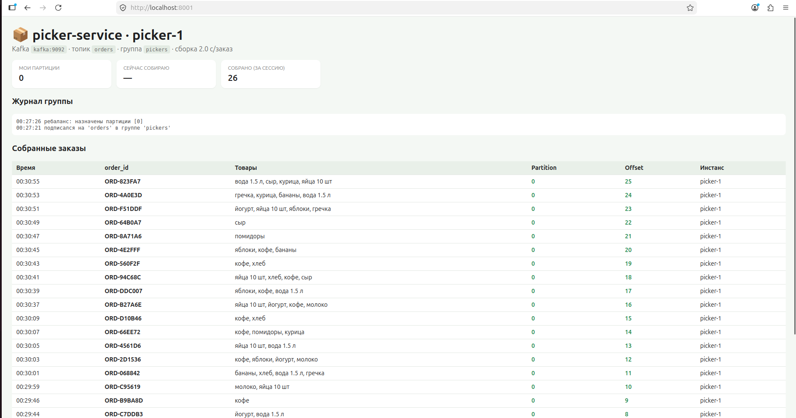

## Часть 2. Kafka через конфигурацию

### Kafka в режиме KRaft

ZooKeeper не нужен: роль контроллера выполняет сам кластер Kafka. Контроллеры образуют кворум и выбирают лидера по протоколу Raft, а метаданные кластера (топики, партиции, лидеры) хранятся как лог во внутреннем топике `__cluster_metadata`. На стенде один узел в режиме **combined** (`broker,controller`); в проде обычно 3 отдельных контроллера, чтобы кворум пережил потерю одного.

```yaml
KAFKA_NODE_ID: 1
KAFKA_PROCESS_ROLES: broker,controller
KAFKA_CONTROLLER_QUORUM_VOTERS: 1@kafka:9093
CLUSTER_ID: "q1Sh-9_ISia_zwGINzRvyQ"

KAFKA_LISTENERS: INTERNAL://:9092,CONTROLLER://:9093,EXTERNAL://:9094
KAFKA_ADVERTISED_LISTENERS: INTERNAL://kafka:9092,EXTERNAL://localhost:9094
```

- **`LISTENERS`** — где брокер слушает; **`ADVERTISED_LISTENERS`** — какой адрес он сообщает клиентам после bootstrap. Контейнеры подключаются к `kafka:9092`, хост — к `localhost:9094`. Если бы брокер «рекламировал» контейнерам `localhost`, они подключались бы сами к себе.
- **Replication factor 1** для `__consumer_offsets` и transaction log: на одном брокере трёх реплик быть не может, без этой настройки consumer group не заработает.
- **`KAFKA_AUTO_CREATE_TOPICS_ENABLE: "false"`.** Топик не должен появиться «случайно» от первой записи с дефолтными параметрами: он создаётся только из конфигурации.
- **`KAFKA_GROUP_INITIAL_REBALANCE_DELAY_MS: 0`** — убирает 3-секундную паузу перед первым ребалансом.
- **`KAFKA_OFFSETS_RETENTION_MINUTES: 10080`** — сколько брокер помнит offset'ы пустой группы (ситуация 3).
- **Volume `kafka-data`** — лог переживает пересоздание контейнера.
- **Healthcheck** (`kafka-broker-api-versions.sh`): `healthy` означает, что брокер отвечает по API, а не просто что процесс запущен.

Состояние кворума (`kafka-metadata-quorum.sh describe --status`): `LeaderId: 1`, `CurrentVoters: [{"id": 1, ... "CONTROLLER://kafka:9093"}]`, `HighWatermark` растёт — метаданные кластера ведутся как лог.

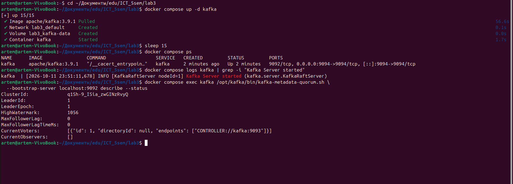

### Топик `orders` из конфигурации: init-контейнер `kafka-init`

В compose нет объекта «топик» (как `KafkaTopic` у Strimzi), поэтому используется паттерн **one-shot init-контейнер**: отдельный контейнер на том же образе дожидается готовности брокера, приводит топик к описанному состоянию и завершается.

```yaml
kafka-init:
  depends_on:
    kafka:
      condition: service_healthy        # ждать готовности брокера, а не запуска контейнера
  environment:
    TOPIC_NAME: orders
    TOPIC_PARTITIONS: 3                 # уменьшить нельзя — только новый топик + миграция
    TOPIC_RETENTION_MS: 172800000       # 2 дня
    TOPIC_SEGMENT_MS: 3600000           # сегмент закрывается раз в час
```

Скрипт работает по принципу **«желаемое состояние → reconcile»**:

1. `kafka-topics.sh --create --if-not-exists` — создать топик, если его нет;
2. прочитать фактическое `PartitionCount` и, если оно отличается от `TOPIC_PARTITIONS`, выполнить `--alter --partitions`;
3. `kafka-configs.sh --alter --add-config retention.ms=…,segment.ms=…` — безопасно повторять при каждом запуске;
4. `--describe` в лог — фактическое состояние.

Почему так:

- **Идемпотентность.** `docker compose up -d` перезапускает init-контейнер при каждом применении конфига; повторный запуск ничего не ломает (при втором запуске в логе `партиций сейчас: 3, нужно: 3`).
- **Нет расхождения конфига и реальности.** Первая версия скрипта делала только `--create --if-not-exists`: при смене `TOPIC_PARTITIONS` она молча ничего не делала, и конфиг расходился с кластером. Reconcile это исправил.
- **Громкий отказ.** Если Kafka отклоняет изменение, `set -e` завершает контейнер с ошибкой, и `docker compose up` падает (работающие сервисы при этом продолжают работать).
- **Это не «ручной CLI».** Источник правды — блок `environment` в `docker-compose.yml`, который хранится в git и проходит ревью. Скрипты `kafka-*.sh` здесь исполнитель, так же как оператор Strimzi приводит кластер к описанию `KafkaTopic` через Admin API. Изменение топика через Kafka UI откатилось бы при следующем `up`.
- `$$VAR` в compose — экранирование: переменную раскрывает bash внутри контейнера, а не compose на хосте.

Первый запуск: брокер `healthy`, `kafka-init` завершился с кодом 0 и создал топик (`Created topic orders.`).

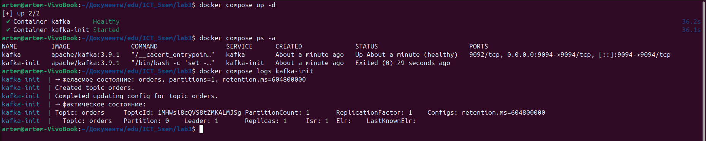

### Сервисы и порядок запуска

Цепочка: `kafka (healthy)` → `kafka-init (exited 0)` → сервисы (`depends_on: condition: service_completed_successfully`), поэтому продюсер не стартует раньше топика. Сборщики описаны через YAML-якоря `x-picker` / `x-picker-env`: общая часть пишется один раз, у каждого экземпляра отличаются только имя, `INSTANCE_NAME` и порт.

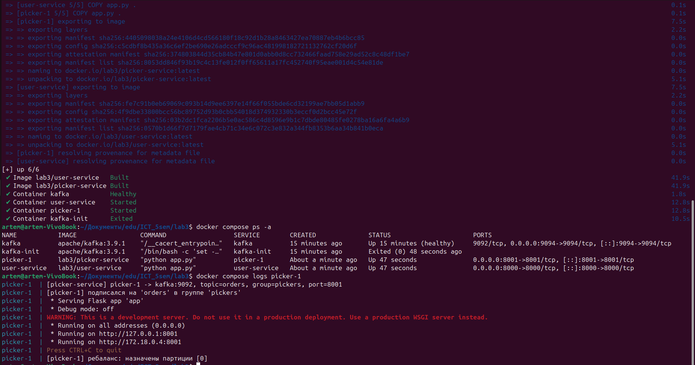

Сквозная проверка: заказы, созданные на `localhost:8000`, появляются у сборщика с теми же `order_id`, partition и offset. 10 заказов, записанных за одну секунду, один сборщик собрал за 20 секунд (по 2 с) — Kafka сработала как буфер для пика, лаг вырос до 10 и снизился до 0.

---

## Часть 3. Ситуации, решённые через конфигурацию

### Ситуация 1. Подготовка к распродаже и возврат после неё

**Проблема.** С одной партицией второй сборщик не ускорит обработку: внутри consumer group каждая партиция назначается максимум одному консьюмеру — так Kafka сохраняет порядок внутри партиции. **Потолок параллелизма группы = число партиций.**

**Изменение.** `TOPIC_PARTITIONS: 1 → 3`, `docker compose up -d`.

- `kafka-init`: `партиций сейчас: 1, нужно: 3` → `меняю число партиций: 1 → 3`, describe: `PartitionCount: 3`.
- Клиентская библиотека сборщика: `Topic orders partition count changed from 1 to 3`, затем ребаланс: `отозваны [0]` → `назначены [0, 1, 2]`.
- На странице user-service новые заказы распределяются по партициям 0, 1, 2; offset у каждой партиции свой.

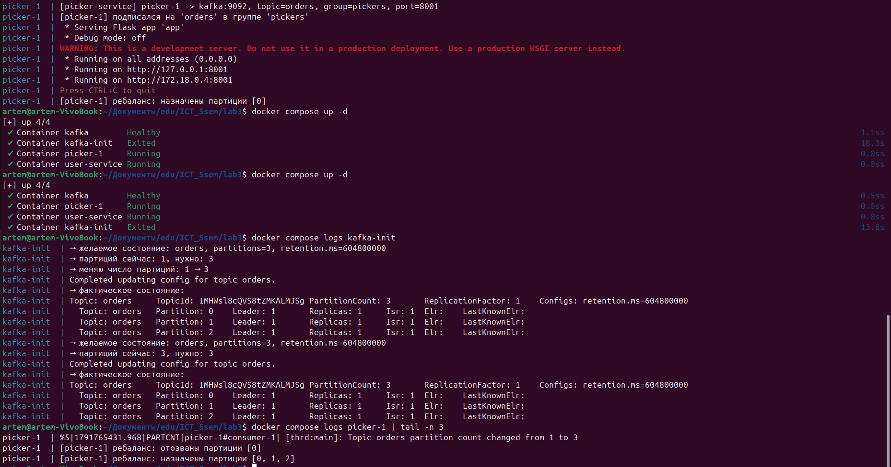

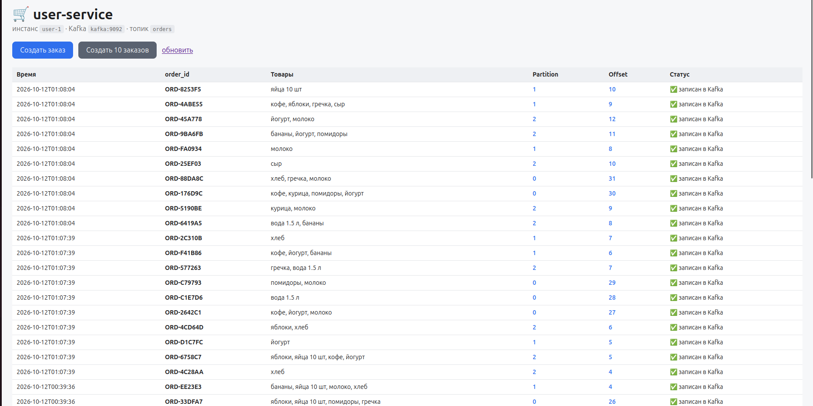

**Возврат после распродажи.** `TOPIC_PARTITIONS: 3 → 1` — Kafka отказала:

```
InvalidPartitionsException: The topic orders currently has 3 partition(s); 1 would not be an increase.
```

`docker compose up` завершился ошибкой `service "kafka-init" didn't complete successfully: exit 1`, работающие сервисы остались в состоянии `Running`. Конфиг вернули к 3, чтобы он совпадал с реальностью.

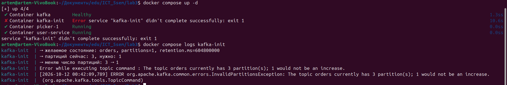

**Почему уменьшить нельзя.**
- Партиция — append-only лог со своими offset'ами. Сообщения партиции 2 некуда деть: при переносе в другие партиции они получили бы новые offset'ы.
- Закоммиченные позиции групп хранятся отдельно для каждой партиции (`pickers / orders-2 → N`); после «слияния» они потеряли бы смысл — пропуски или повторная обработка.
- Партиция выбирается как `hash(key) % N`: при смене N меняется маппинг всех ключей, и события одного заказа оказались бы в разных партициях — гарантия порядка исчезла бы.
- Уменьшить можно только миграцией: новый топик с нужным числом партиций, перенос данных, переключение продюсеров и консьюмеров.

**Что реально уменьшается после пика — число консьюмеров, а не партиций.** Лишние партиции стоят недорого (файлы и память брокера, чуть дольше ребаланс), один сборщик спокойно читает все три. Поэтому партиции берут с запасом, а масштабируют сборщиков: после распродажи блоки `picker-3`/`picker-4` удалены из конфига и применены через `docker compose up -d --remove-orphans`.

**Почему готовиться заранее.** Существующие сообщения при добавлении партиций не переезжают, меняется только маппинг для новых. Если «создан» пришёл до расширения, а «собран» после, события одного заказа окажутся в разных партициях: возможна обработка не по порядку, гонки, потерянные переходы состояний. Расширять нужно в тихое окно, когда лаг близок к нулю.

Неравномерность данных по партициям в Kafka UI (48 / 27 / 24) — следствие этого же: первые заказы записаны, пока партиция была одна, а добавленные партиции старых данных не получают.

### Ситуация 2. Второй сборщик в той же группе

**Изменение.** Сервис `picker-2` (`KAFKA_GROUP_ID: pickers`, порт `8002`).

- Ребаланс: `picker-1 → [0, 1]`, `picker-2 → [2]`.
- 10 заказов легли как 3 / 3 / 4 по партициям. `picker-1` собрал 6 заказов за 12 с, `picker-2` — 4 заказа за 8 с: **12 с вместо 20**. Общее время определяет самый загруженный консьюмер; ускорение неполное, потому что 3 партиции на 2 консьюмера не делятся поровну, а ключи распределяются неравномерно.

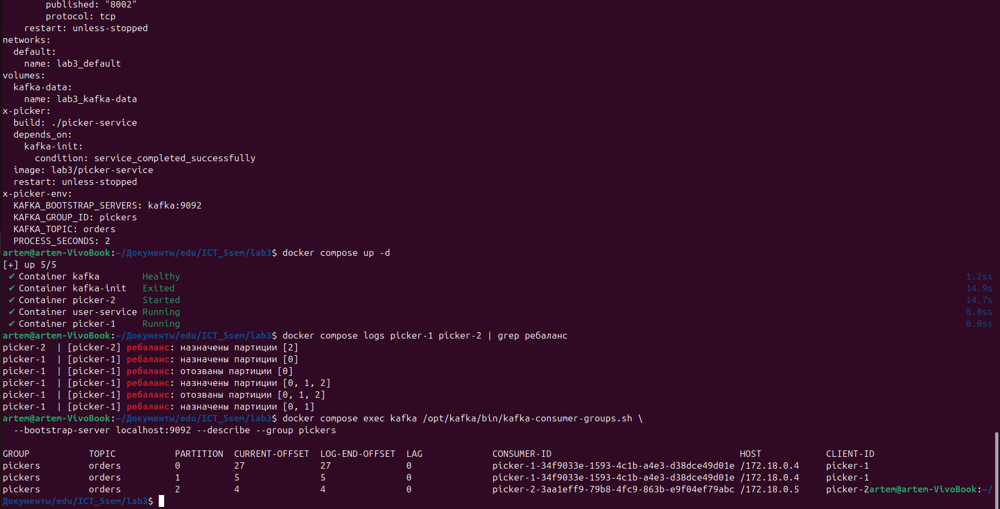

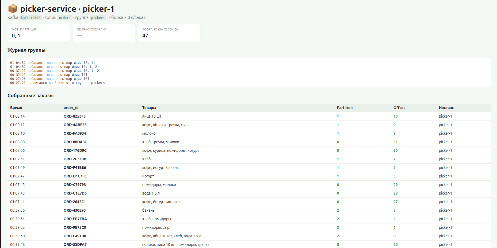

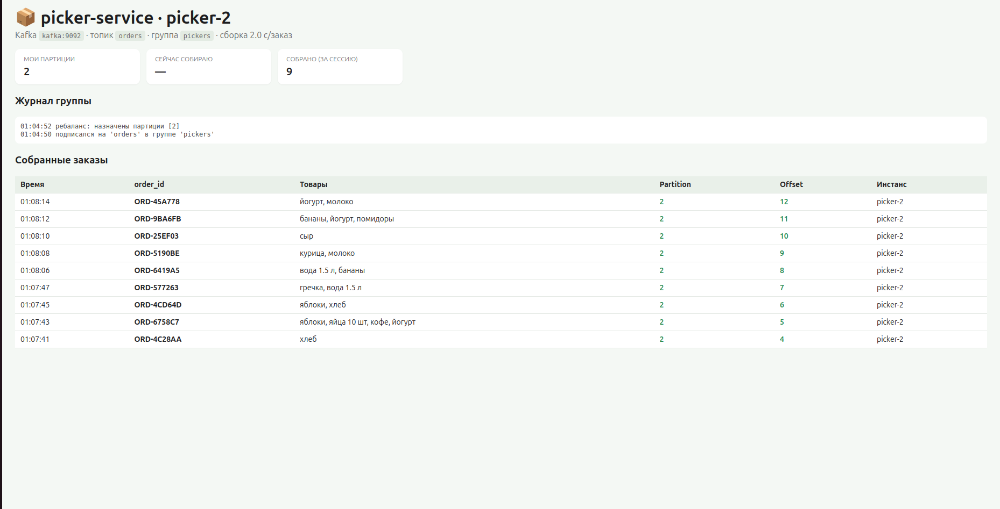

**Больше сборщиков, чем партиций** (`docker-compose.sale.yml`, 4 сборщика): `picker-1 → [0]`, `picker-2 → [1]`, `picker-3 → [2]`, `picker-4 → нет (лишний консьюмер)`.

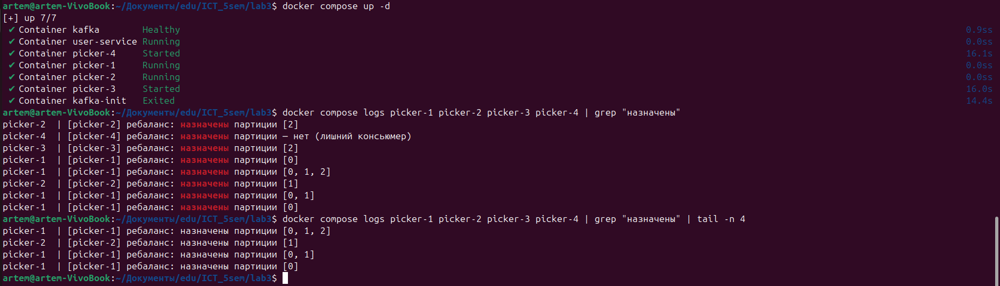

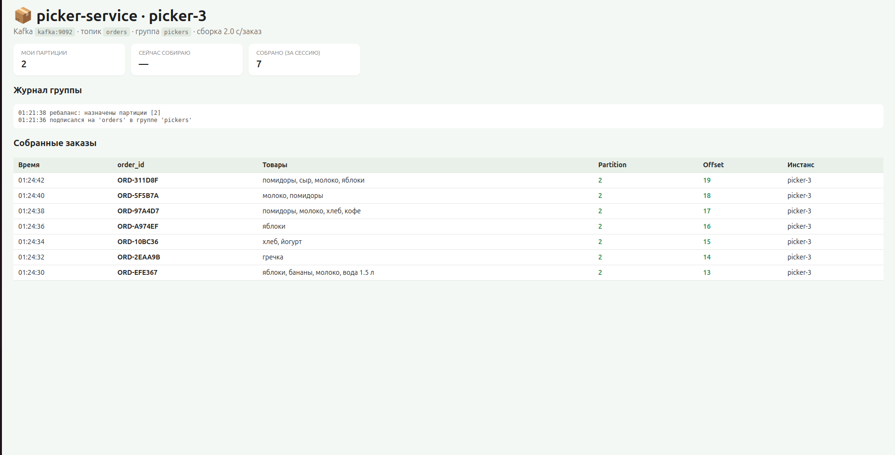

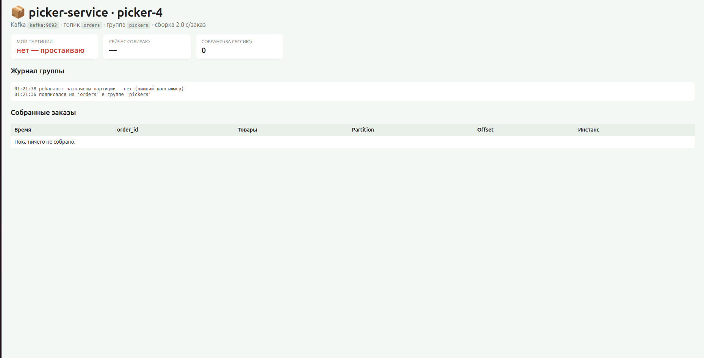

Простаивающий сборщик — **горячий резерв**: он получит партицию, когда работающий консьюмер покинет группу — сразу при корректной остановке (LeaveGroup), через `session.timeout.ms` (45 с) при падении или через `max.poll.interval.ms` (5 мин) при зависании в обработке. Резерв продолжит с последнего закоммиченного offset'а прежнего владельца.

При стандартной стратегии назначения партиции на ребалансе раздаются заново (у `picker-2` партиция `[2]` сменилась на `[1]`); стратегия `cooperative-sticky` переносит только необходимый минимум.

### Ситуация 3. Сборщики упали во время деплоя

**Эксперимент.** `docker compose stop picker-1 picker-2`, создано 5 заказов.

```
Consumer group 'pickers' has no active members.
PARTITION  CURRENT-OFFSET  LOG-END-OFFSET  LAG
0          41              43              2
1          15              18              3
2          20              20              0
```

Сумма лагов = 5 — ровно заказы, созданные во время простоя. После `docker compose start` `picker-1` собрал offset'ы 41, 42 (партиция 0) и 15, 16, 17 (партиция 1) — начал **точно с закоммиченной позиции**: не с нуля (старые заказы повторно не собраны) и не с конца (новые не пропущены).

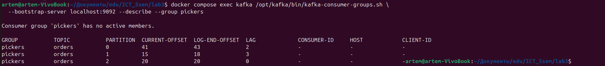

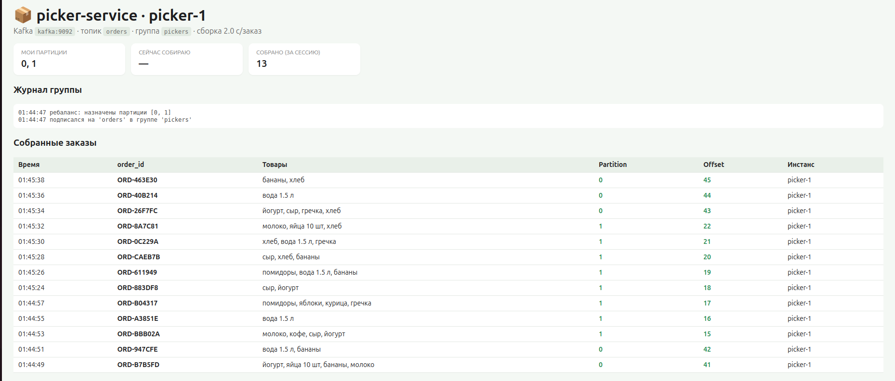

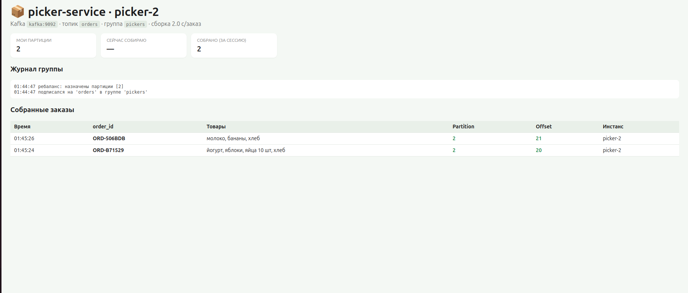

**Почему заказы не потерялись.**
1. Заказы лежат в логе партиций на диске брокера; чтение их не удаляет, удаляет только retention.
2. Позиция группы — закоммиченный offset во внутреннем топике `__consumer_offsets` (ключ — группа + топик + партиция); по нему сборщик знает, откуда продолжить.
3. `auto.offset.reset` срабатывает **только когда валидного коммита нет**: новая группа; группа пустовала дольше `offsets.retention.minutes`; коммит указывает на данные, уже удалённые retention. При `latest` консьюмер встал бы в конец лога и пропустил бы всё созданное за простой; при `earliest` начнёт с самого раннего доступного сообщения.

**Что сделано явным в конфигурации:**

| Настройка | Где | Что защищает |
|---|---|---|
| `retention.ms` топика | `kafka-init` | сообщения живут дольше максимального простоя |
| `offsets.retention.minutes=10080` | `kafka` | группа не «забывает» позицию, пока сборщики лежат (`STATIC_BROKER_CONFIG` в `kafka-configs --describe`) |
| `AUTO_OFFSET_RESET=earliest` | `x-picker-env` | при отсутствии коммита — перечитать, а не потерять |
| коммит после обработки | код сборщика | at-least-once: сбой посреди сборки не теряет заказ |
| `acks=all`, volume `kafka-data` | код продюсера, `kafka` | запись подтверждена брокером и переживает пересоздание контейнера |

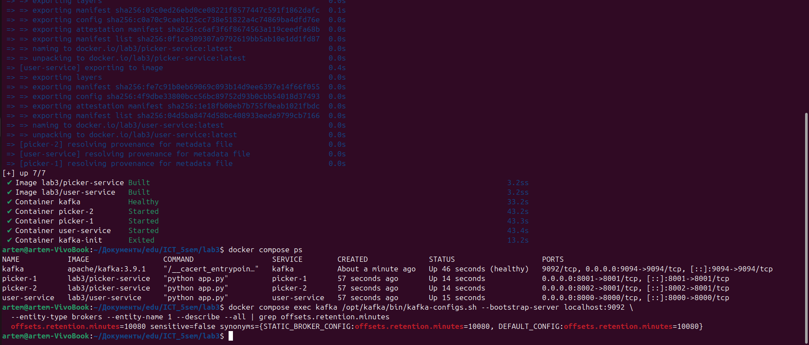

**At-least-once и идемпотентность.** Если сборщик упадёт посреди сборки, offset ещё не закоммичен, и после рестарта заказ придёт повторно. Поэтому обработчик должен быть идемпотентным: «заказ ORD-X уже собран — пропустить».

`earliest` не возвращает удалённое: если простой длиннее retention, заказы между старым коммитом и новым началом лога потеряны при любой настройке. Единственная защита — retention больше возможного простоя **и** алерт, который сработает задолго до этого предела (часть 6).

---

## Часть 4. Kafka UI

```yaml
kafka-ui:
  image: provectuslabs/kafka-ui:v0.7.2
  environment:
    KAFKA_CLUSTERS_0_NAME: lab3-local
    KAFKA_CLUSTERS_0_BOOTSTRAPSERVERS: kafka:9092   # UI живёт в docker-сети
  ports:
    - "127.0.0.1:8080:8080"
```

Bootstrap-адрес — `kafka:9092`, а не `localhost:9094`: внутри контейнера `localhost` — сам контейнер. Адрес клиента зависит от того, где клиент находится.

Что видно в UI:
- **Dashboard:** кластер `lab3-local` Online, 1 брокер, 53 партиции (3 у `orders` + 50 у `__consumer_offsets`).
- **Topic `orders`:** 3 партиции, RF 1, URP 0, In Sync Replicas 3 of 3, сообщения по партициям.
- **Settings:** `retention.ms` — значение, выставленное `kafka-init`; `cleanup.policy=delete`; `segment.bytes=1073741824`.
- **Consumers → `pickers`:** STABLE, 2 участника, координатор — брокер 1, лаг по партициям.

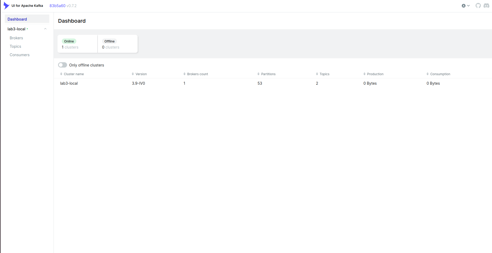

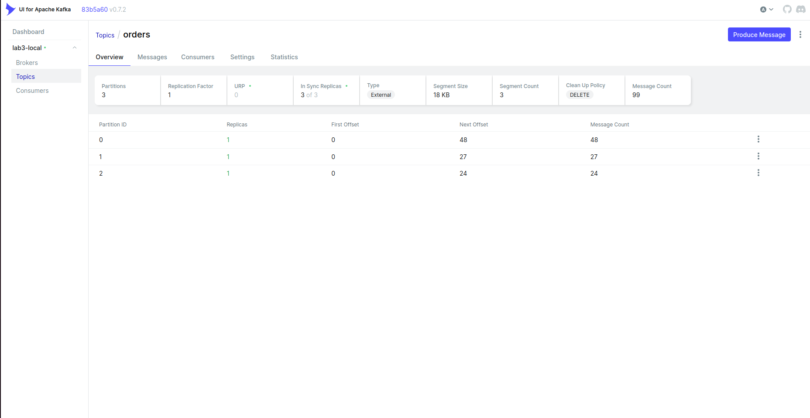

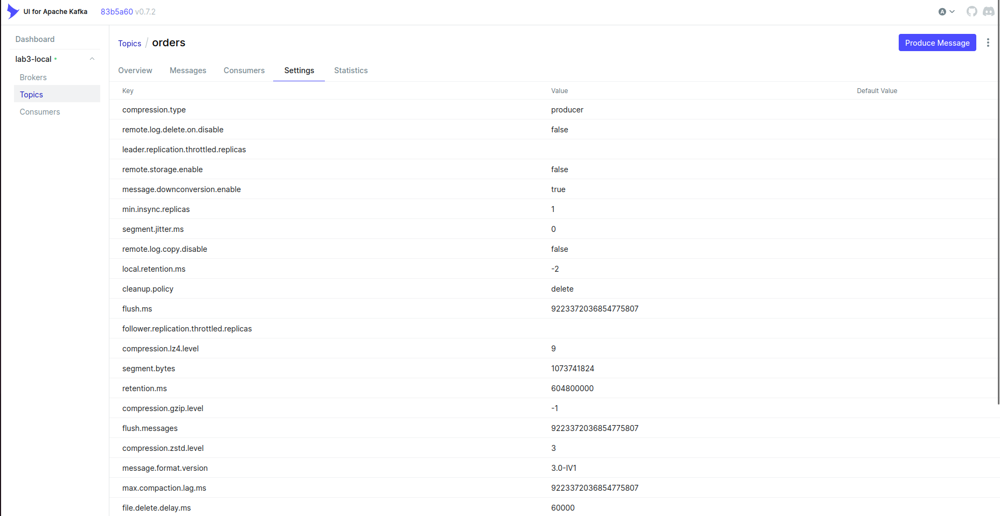

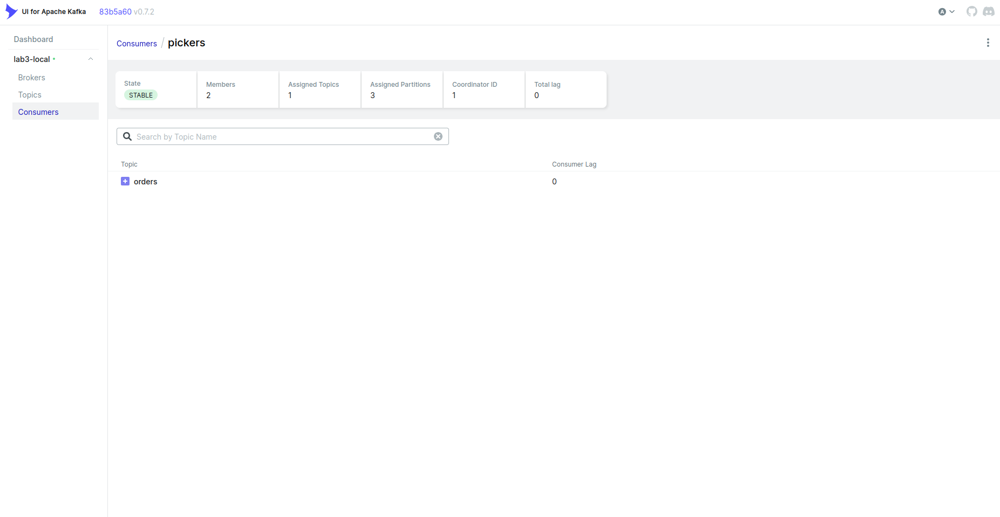

## Часть 5. Ситуации, решённые через Kafka UI

### Ситуация 4. Расследование жалобы на заказ

Порядок расследования (выполняется целиком в Kafka UI): в **Topics → orders → Messages** поиск по `order_id` находит сообщение: partition, offset, timestamp, key = `order_id`, value — JSON заказа. На больших топиках поиск сужают выбором партиции (она однозначно определяется ключом) или **Seek Type → Timestamp** от времени жалобы.

Обработан ли заказ — в **Consumers → pickers**: закоммиченный offset — номер **следующего** сообщения, которое прочитает группа, поэтому

> заказ обработан ⇔ его offset **<** Consumer Offset группы в этой партиции

Незабранный заказ входит в лаг своей партиции, группа в состоянии EMPTY. После `docker compose start` Consumer Offset становится больше offset'а заказа, лаг — 0.


**Просмотр сообщений не мешает сборщикам.** Kafka UI читает своим консьюмером вне группы `pickers` и ничего за неё не коммитит. Внутри одной группы консьюмеры делят партиции и общий закоммиченный offset; разные группы (или консьюмер без группы) независимы, у каждой свои offset'ы. Offset'ы привязаны к группе, а не к топику. В RabbitMQ «Get messages» с ack удаляет сообщение из очереди: там «посмотреть» и «забрать» — одно действие.

### Ситуация 5. Пересчёт истории для аналитики

1. `docker compose stop picker-1 picker-2` — Kafka не даёт сбросить offset'ы группе с активными участниками (они сами коммитят позиции, сброс устроил бы гонку). Группа перешла в **EMPTY**.
2. **Consumers → pickers → Reset offset**: topic `orders`, Reset Type `EARLIEST`, все партиции. Consumer Lag стал **99** — ровно число сообщений в топике.
3. `docker compose start picker-1 picker-2` — сборщики пересобрали все заказы с offset 0, лаг снизился до 0.

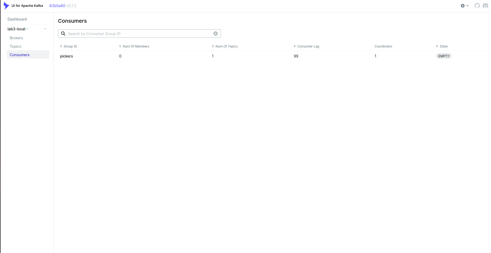

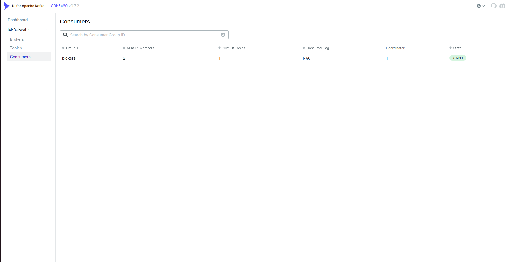

**Почему Kafka это позволяет, а очередь — нет.** Kafka — лог: сообщения живут независимо от чтения и удаляются только по retention, а позиция группы — просто число, которое группа хранит отдельно в `__consumer_offsets`. В классической очереди отдельной позиции нет: чтение с ack удаляет сообщение.

**Насколько далеко назад.** Replay возможен до самой ранней записи, которая ещё физически есть в партиции, — до log start offset; он сдвигается retention'ом.

**Как правильно в продакшене.** Сброс offset'ов рабочей группы означает повторную сборку реальных заказов. Аналитикам нужна **отдельная consumer group** (например, `analytics` с `auto.offset.reset=earliest`): Kafka позволяет любому числу групп читать одни и те же партиции, у каждой свои offset'ы, и `pickers` это не затрагивает.

### Ситуация 6. Диск забивается старыми заказами

**Изменение через конфиг** (а не в UI — иначе reconcile `kafka-init` откатил бы правку при следующем `up`). Для демонстрации «пара дней» масштабирована до минут:

```yaml
TOPIC_RETENTION_MS: 120000    # демонстрация: 2 минуты
TOPIC_SEGMENT_MS: 60000       # демонстрация: сегмент закрывается раз в минуту
KAFKA_LOG_RETENTION_CHECK_INTERVAL_MS: 30000   # брокер: проверять retention раз в 30 с (временно)
```

**Демонстрация «прочитано, но удалено».** Партия A (5 заказов) собрана, лаг группы 0. Через 1,5 минуты — партия B (3 заказа), её запись закрыла сегмент с партией A. Ещё через несколько минут:

| Партиция | Партия A (прочитана) | Партия B | First → Next offset | Осталось |
|---|---|---|---|---|
| 0 | 57, 58 | 59 | 59 → 60 | только B |
| 1 | 41 | 42, 43 | 42 → 44 | только B |
| 2 | 35, 36 | — | 37 → 37 | 0 сообщений |

Вся партия A удалена, хотя группа её прочитала (Total lag 0); партия B на месте. Граница удаления прошла точно по стыку партий — **retention удаляет сегменты целиком**. В пустой партиции 2 `First = Next = 37`: offset'ы не начинаются заново, следующее сообщение получит 37, поэтому сохранённые позиции групп не начинают указывать на чужие сообщения.

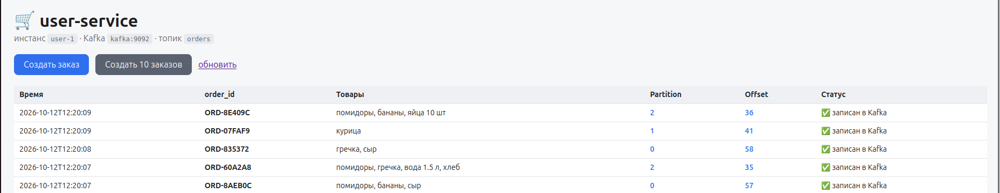

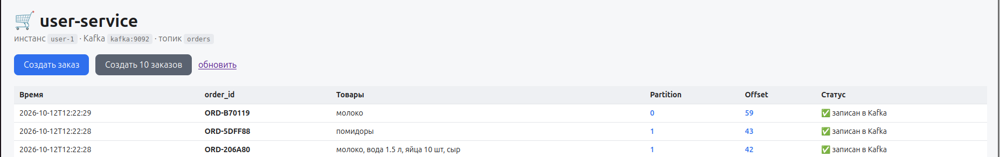

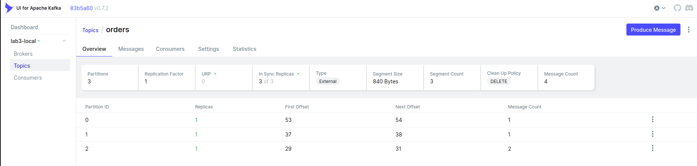

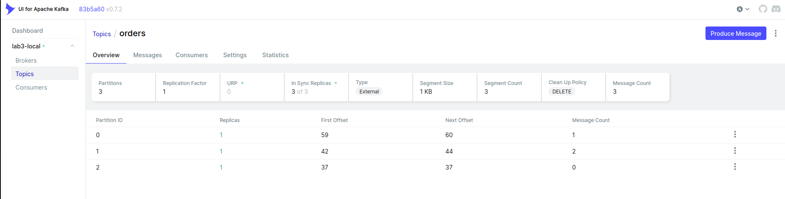

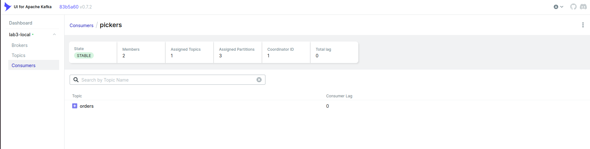

**Почему нужен `segment.ms`.** Сегмент удаляется, когда **самое новое** сообщение в нём старше `retention.ms`. При первом запуске (без `segment.ms`) удалились сразу все сообщения: новых заказов не было, и единственный (активный) сегмент целиком «просрочился». Но при постоянном потоке в активный сегмент всё время пишутся свежие сообщения, он не закрывается до `segment.bytes` (1 ГБ) или `segment.ms` (по умолчанию 7 дней), и старые данные в нём живут до `retention.ms + segment.ms`. `retention.ms` задаёт цель, `segment.ms` — гранулярность; `segment.ms` выбирают не больше retention.

**Итоговая конфигурация** — реальное требование «пара дней»: `retention.ms=172800000` (2 дня), `segment.ms=3600000` (1 час), ускоренная проверка retention у брокера убрана.

**Риск.** Kafka удаляет по политике, а не по прочтению: если сборщики пролежат дольше retention, непрочитанные заказы удалятся, закоммиченный offset окажется за началом лога, и сработает `auto.offset.reset`. Отсюда алерты в части 6.

---

## Часть 6. Мониторинг

### Стек

Kafka сама не отдаёт метрики в формате Prometheus, поэтому добавлены экспортеры:

- **kafka-exporter** подключается к Kafka как клиент (Admin API) и отдаёт метрики кластера и групп: брокеры, offset'ы партиций, лаг групп, реплики;
- **node-exporter** отдаёт метрики хоста: volume `kafka-data` лежит на диске хоста, поэтому «место под лог Kafka» — это свободное место корневого раздела;
- **Prometheus** опрашивает экспортеры раз в 10 секунд (pull-модель), хранит ряды в volume `prometheus-data`, вычисляет правила алертов;
- **Grafana** настроена через **provisioning**: источник данных и дашборд создаются из файлов при старте, поэтому Grafana stateless — пересоздание контейнера ничего не теряет, дашборд хранится в git как JSON. `allowUiUpdates: false` — источник правды файл.

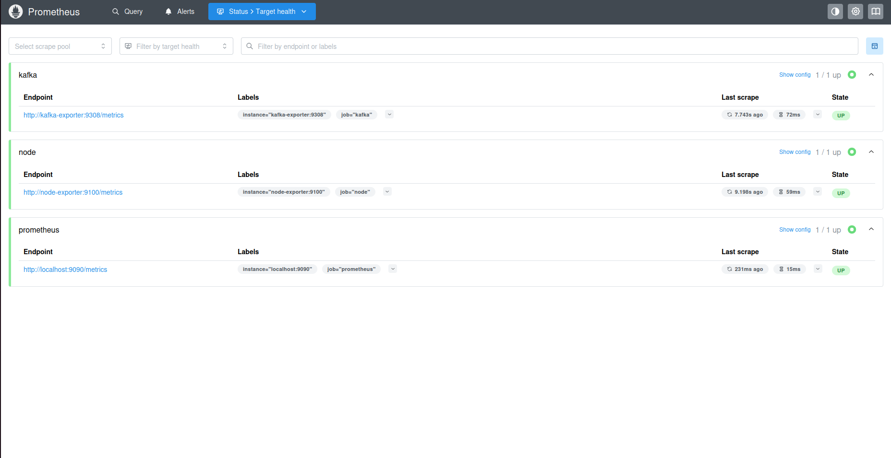

Первая проверка в Prometheus — суммарный лаг группы во время простоя сборщиков: рост до 30 и спад до 0 после возвращения. И свободное место на диске хоста (node-exporter):

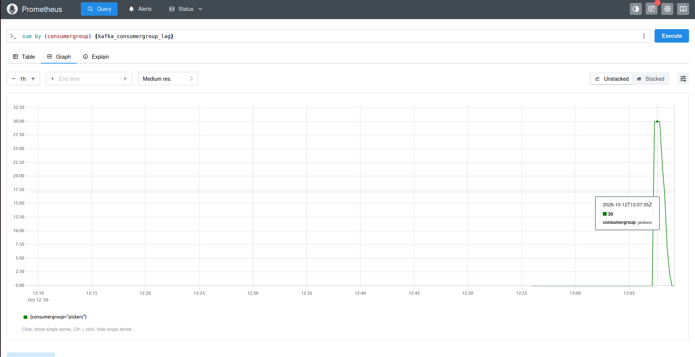

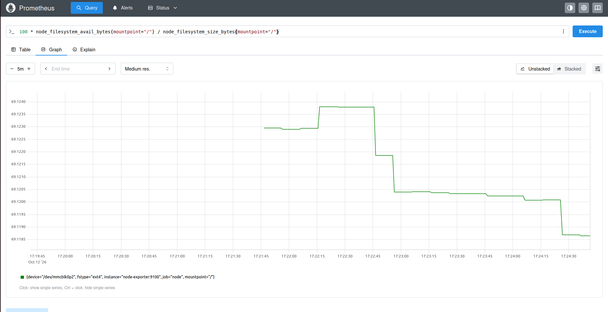

### Дашборд «Kafka — заказы (lab3)»

| Группа сигналов | Панель | Запрос | На какой вопрос отвечает |
|---|---|---|---|
| Отставание | Лаг pickers, всего | `sum(kafka_consumergroup_lag_sum{consumergroup="pickers"})` | Сколько заказов ждут сборки? |
| Отставание | Лаг по партициям | `kafka_consumergroup_lag{consumergroup="pickers"}` | Где копится отставание: одна партиция — горячий ключ или зависший консьюмер? |
| Отставание | Сборщиков в группе | `kafka_consumergroup_members{consumergroup="pickers"}` | Есть ли кому собирать? |
| Пропускная способность | Поток: пришло vs собрано | `sum(rate(kafka_topic_partition_current_offset{topic="orders"}[1m]))` и `sum(rate(kafka_consumergroup_current_offset{consumergroup="pickers"}[1m]))` | Успевают ли сборщики за потоком? |
| Хранение | Сообщений в orders / по партициям | `kafka_topic_partition_current_offset − kafka_topic_partition_oldest_offset` | Работает ли retention, сколько хранится? |
| Здоровье кластера | Живых брокеров | `kafka_brokers` | Все ли брокеры доступны? |
| Здоровье кластера | Недореплицированные партиции | `sum(kafka_topic_partition_under_replicated_partition)` | Не деградировала ли репликация? |
| Ресурсы | Свободно на диске, % | `100 * node_filesystem_avail_bytes{mountpoint="/"} / node_filesystem_size_bytes{mountpoint="/"}` | Сколько места осталось под лог? |
| Ресурсы | Доступная память, % | `100 * node_memory_MemAvailable_bytes / node_memory_MemTotal_bytes` | Хватает ли памяти брокеру? |

Сам по себе `current_offset` — просто растущее число; смысл имеет его скорость (`rate`), то есть пропускная способность.

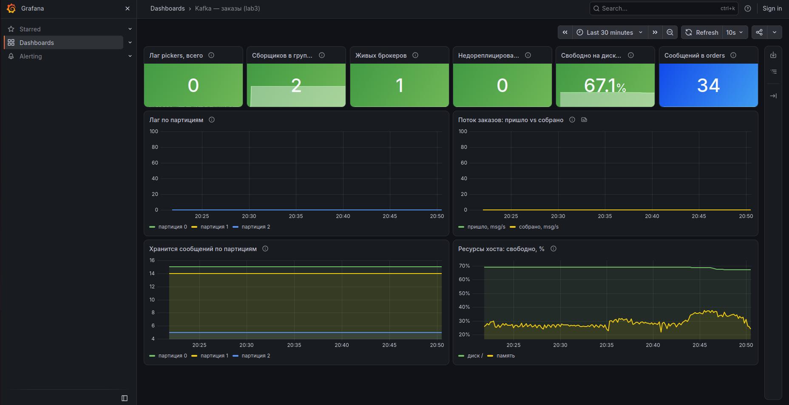

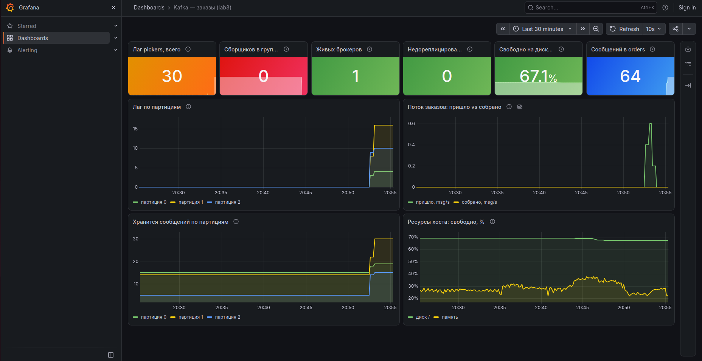

Во время простоя: «Сборщиков в группе» = 0 (красный), лаг вырос до 30 тремя «ступеньками», «пришло» выше нуля при нулевом «собрано».

### Три алерта

Правила — `monitoring/alerts.yml`, подключены через `rule_files` в `prometheus.yml`. Принцип выбора: алерт срабатывает на **симптом, который скоро ударит по бизнесу**, а не на любое отклонение. «Лаг > 0» был бы плохим алертом: при нажатии «Создать 10 заказов» лаг на секунды становится 10 при здоровой системе.

#### 1. `PickersDownWithBacklog` — заказы копятся, а собирать некому (critical)

```yaml
expr: |
  sum(kafka_consumergroup_lag_sum{consumergroup="pickers", topic="orders"}) > 0
  and on()
  (sum(kafka_consumergroup_members{consumergroup="pickers"}) or vector(0)) == 0
for: 2m
```

- **Что ловит.** Сборщики упали, не стартовали после деплоя, крутятся в crash-loop или застряли в бесконечном ребалансе. Группа пуста — никто не читает партиции, само не восстановится. Это точнее, чем «лаг растёт»: лаг может расти и при живых сборщиках, если выросла нагрузка, а ноль участников однозначно указывает на консьюмеров.
- **Чем грозит.** Заказы не собираются, клиент видит «собирается» бесконечно. Если простой перевалит за `retention.ms` (2 дня), заказы этого окна удалятся и потеряются навсегда, даже после починки.
- **Порог.** `== 0` — жёстко: один живой сборщик уже читает. `lag > 0` отсекает пустую группу при отсутствии заказов. `for: 2m` — дольше штатного рестарта (секунды) и короче, чем человек заметит вручную. `or vector(0)` — пропавший ряд `members` считается нулём; лаг стоит слева от `and`, поэтому в описании алерта `$value` — число ждущих заказов.

#### 2. `OrdersStoppedArriving` — заказы перестали поступать (warning)

```yaml
expr: (sum(rate(kafka_topic_partition_current_offset{topic="orders"}[5m])) or vector(0)) == 0
for: 10m
```

- **Что ловит.** Продюсер замолчал: упал user-service, сломался upstream, ошибка в бизнес-логике. Самый коварный класс отказа: лаг 0, консьюмеры живы, ошибок нет, брокер в норме — дашборд зелёный, а бизнес стоит.
- **Чем грозит.** Заказы не создаются; ни один алерт на лаг или ошибки не сработает, в реальности это выясняется от клиентов через часы.
- **Порог.** Берётся `rate`, а не абсолютный offset: он монотонно растёт и нулём не станет. `sum` по партициям: остановка одной партиции — перекос, а не «перестали поступать». `for: 10m` подбирается под естественный ритм заказов; в проде алерт ограничивают рабочими часами магазина, иначе ночью будут ложные срабатывания.
- **Кто следит за смотрящим.** Все три алерта зависят от экспортеров: если `kafka-exporter` упадёт, метрик не станет, и условия на пустых рядах молча перестанут выполняться. `or vector(0)` делает этот алерт страховкой: при пропаже метрик скорость считается нулём, и алерт сработает. В описании алерта сказано проверить и продюсер, и `up{job="kafka"}`.

#### 3. `KafkaDiskFillingUp` — диск под логом заканчивается (warning)

```yaml
expr: |
  100 * node_filesystem_avail_bytes{mountpoint="/"} / node_filesystem_size_bytes{mountpoint="/"} < 15
  or
  predict_linear(node_filesystem_avail_bytes{mountpoint="/"}[1h], 4 * 3600) < 0
for: 10m
```

- **Что ловит.** Диск с лог-сегментами подходит к концу. Это предсказательный алерт: срабатывает до отказа. kafka-exporter этого не видит вообще — поэтому нужен node-exporter.
- **Чем грозит.** При заполнении диска Kafka перестаёт принимать записи: продюсеры получают ошибки, кластер фактически останавливается; в худшем случае брокер падает и требует ручного восстановления. Отказа не видно до последнего момента.
- **Порог.** 15% свободного места — запас на реакцию: расширить том, снизить `retention.ms`, найти, кто пишет на диск. При быстром потоке 15% могут сгореть за час, поэтому второе условие — прогноз: при темпе последнего часа место кончится в ближайшие 4 часа. `for: 10m` отсекает кратковременные всплески.

### Проверка алертов

Правила проверены до применения и покрыты unit-тестами:

```bash
docker run --rm -v "$PWD/monitoring:/m:ro" -w /m --entrypoint promtool prom/prometheus:v3.15.0 check rules alerts.yml
docker run --rm -v "$PWD/monitoring:/m:ro" -w /m --entrypoint promtool prom/prometheus:v3.15.0 test rules alerts.test.yml
```

Тесты проверяют: алерт 1 молчит на первой минуте и срабатывает через 2 минуты при 0 сборщиков и лаге 30; при **живых** сборщиках и том же лаге не срабатывает; алерт 2 срабатывает после 10 минут без новых сообщений; алерт 3 — при 12% свободного места.

Вживую на http://localhost:9090/alerts (состояния: inactive → pending, пока не истёк `for` → firing):

- `OrdersStoppedArriving` — на тихом стенде сначала pending, через 10 минут firing (значение 0).

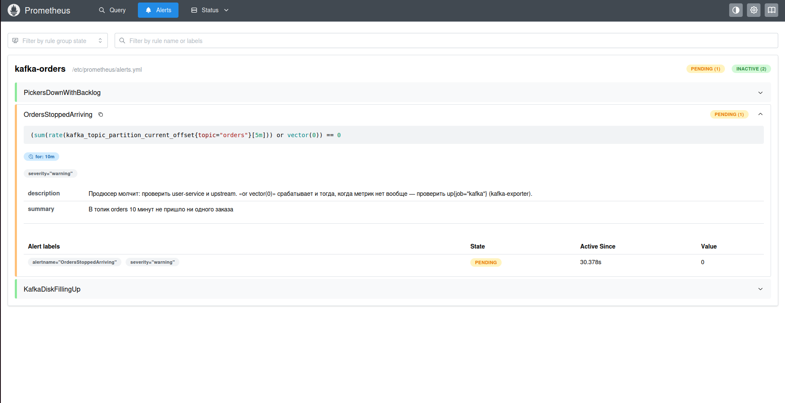

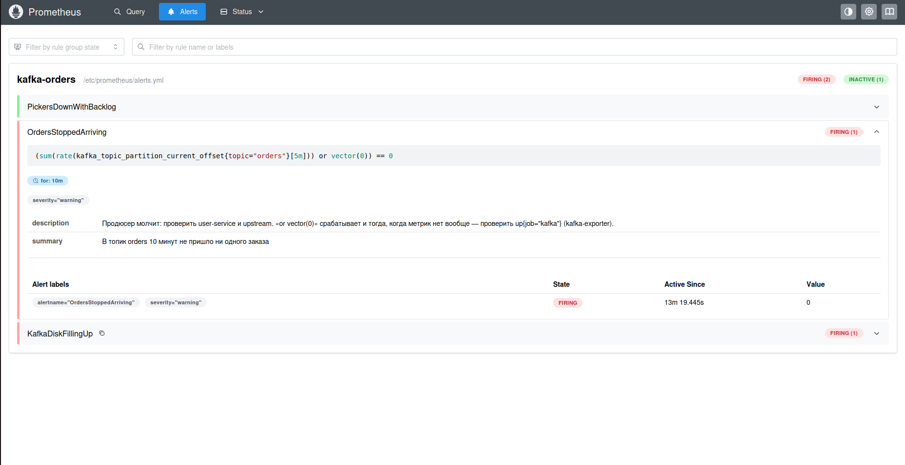

- `KafkaDiskFillingUp` — для демонстрации порог временно поднят до `< 80`: firing со значением 67,1 — то же, что на плитке Grafana. В сдаваемом `alerts.yml` порог возвращён на 15.

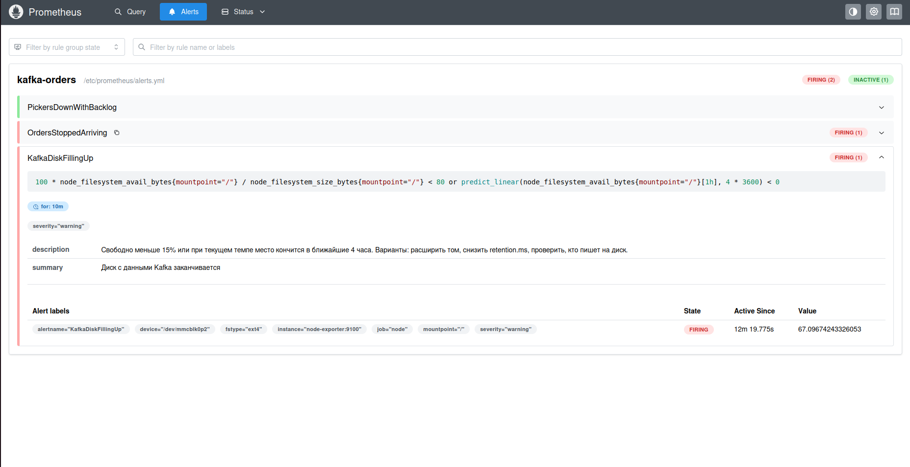

- `PickersDownWithBacklog` — условие алерта (0 сборщиков при лаге 30) видно на дашборде во время простоя (скриншот 34); срабатывание через `for: 2m` и отсутствие ложного срабатывания при живых сборщиках проверены unit-тестами выше.

---

## Ограничения стенда и следующие шаги

- **Один брокер, replication factor 1, `min.insync.replicas=1`.** Потеря диска брокера означает потерю заказов. В проде: 3 брокера, RF=3, `min.insync.replicas=2` — тогда `acks=all` действительно гарантирует наличие копий; отдельный кворум из 3 контроллеров KRaft.
- **Нет метрик ошибок брокера.** `FailedProduceRequestsPerSec`, `FailedFetchRequestsPerSec`, ошибки запросов доступны только через JMX брокера (jmx_exporter как Java-агент). Ошибки обработки на стороне сборщиков в Kafka видны через рост DLQ-топика.
- **Алерты не доставляются.** Следующий шаг — Alertmanager: группировка, подавление дублей, маршрутизация в Telegram/Slack/почту.
- **Безопасность.** PLAINTEXT-слушатели и Kafka UI без авторизации допустимы только локально; в проде — SASL/TLS, авторизация и RBAC в UI или режим `READONLY`.
- **Порядок при расширении партиций.** Для критичных к порядку ключей — расширение через новый топик, а не `--alter`.
- **Ребаланс.** Стратегия `cooperative-sticky` уменьшила бы перемещение партиций между сборщиками.

## Заметка о CLI

Все **изменения** выполнены через конфигурацию (`docker-compose.yml`, `monitoring/*`) или Kafka UI (сброс offset'ов, поиск сообщений). Команды `kafka-*.sh` вручную использовались только для **чтения** состояния: `kafka-metadata-quorum.sh describe`, `kafka-consumer-groups.sh --describe`, `kafka-configs.sh --describe`.
