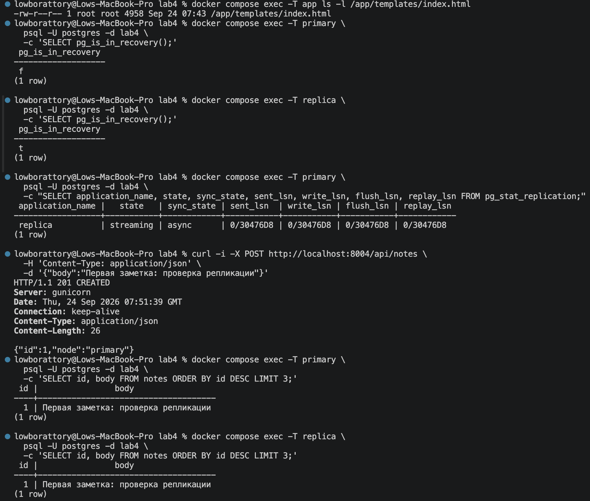
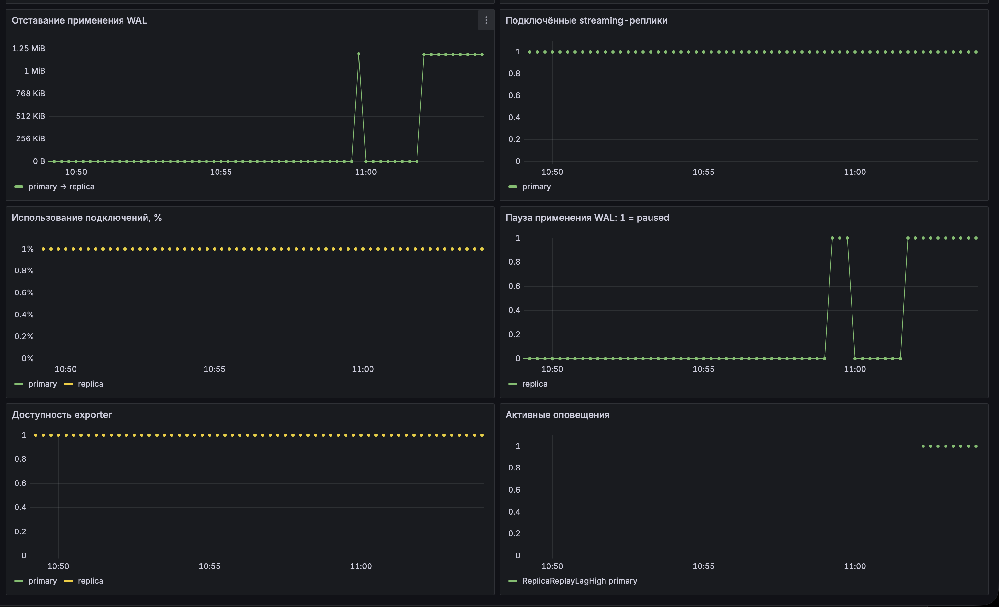
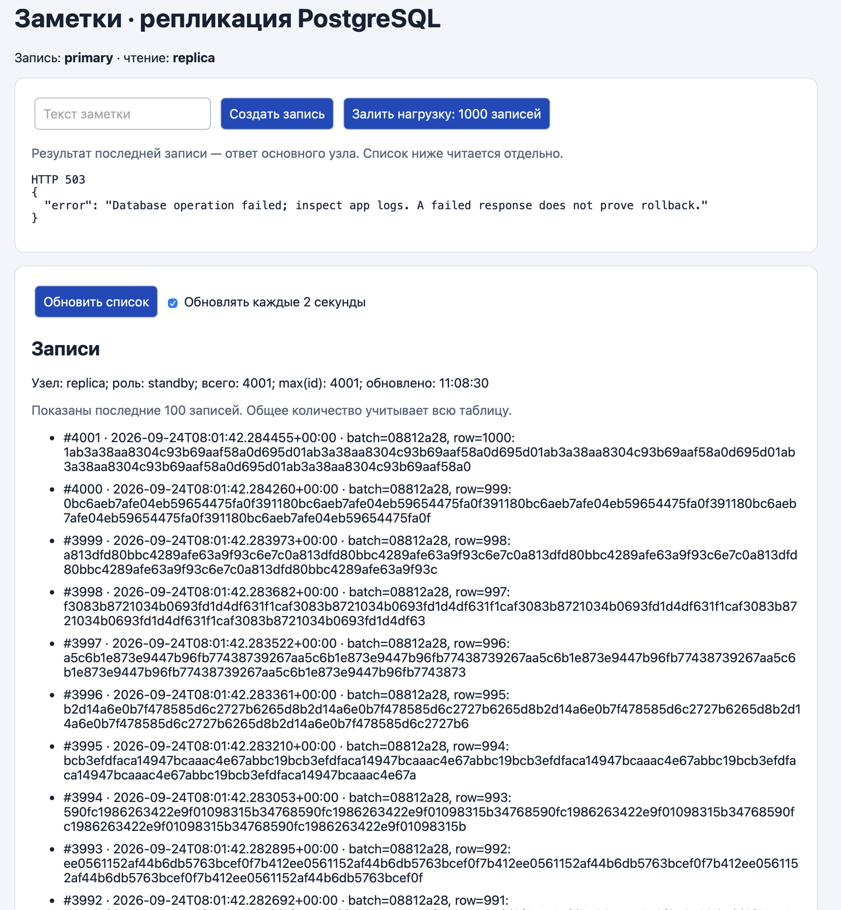
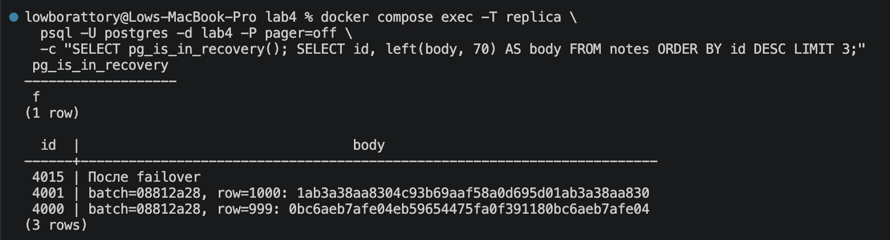
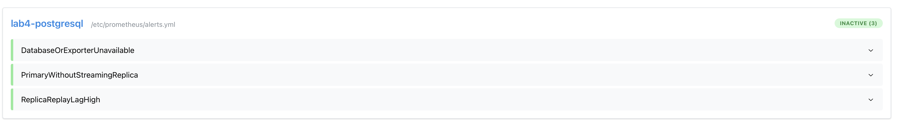
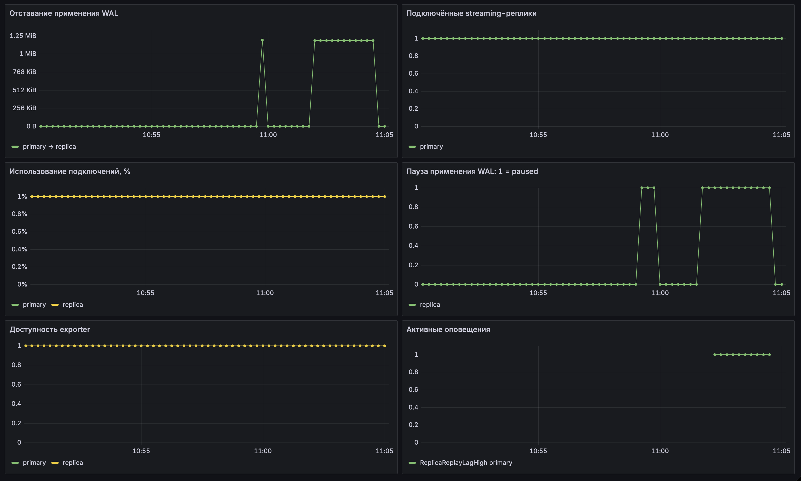
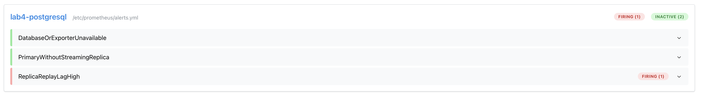

# Lab 4 — PostgreSQL: репликация, failover и мониторинг

В этой работе мы разворачиваем PostgreSQL с основным узлом и репликой, подключаем к ним сервис заметок и проверяем работу репликации. Отдельно исследуем задержку передачи изменений, поведение системы при отказе основного узла и мониторинг состояния базы данных.

## Часть 0. Выбор базы данных

Для работы выбираем PostgreSQL. Необходимо развернуть основной узел и реплику, настроить передачу данных, а затем проверить поведение системы при задержке репликации и отключении основного узла.

Для экспериментов подготавливаем сервис заметок. Через него можно создать запись, открыть список заметок или загрузить сразу 1000 записей. Все компоненты запускаем через Docker Compose, чтобы управлять стендом из единой конфигурации.

## Часть 1. Настройка репликации

Сначала разворачиваем два узла: основной `primary` и резервный `replica`. Для каждого выделяем отдельное хранилище и настраиваем передачу изменений через журнал базы данных.

В конфигурации включаем репликацию и разрешаем чтение данных со второго узла. Также создаём отдельных пользователей для приложения, передачи изменений и мониторинга, назначая каждому необходимые права.

Первоначальную копию базы получаем с помощью `pg_basebackup`. Подготовленный скрипт копирует данные с основного узла, после чего реплика подключается к нему и получает последующие изменения. При повторном запуске скрипт не выполняет полное копирование, если оно уже было подготовлено.

После запуска контейнеров проверяем роли узлов. На основном узле получаем `f`, на реплике — `t`. Эти значения соответствуют результатам проверки режима восстановления и подтверждают ожидаемое разделение ролей.

Затем проверяем соединение между узлами. Состояния `streaming` и `async` показывают, что передача изменений выполняется в асинхронном режиме.

Создаём первую заметку, получаем HTTP 201 и проверяем таблицу на обоих узлах. Запись присутствует и на `primary`, и на `replica`, то есть изменения передаются на резервный узел.

## Часть 2. Подключение сервиса

Сервис разрабатываем на Python с использованием Flask. На странице размещаем поле для заметки, кнопку создания записи, обновление списка и функцию массовой загрузки. Дополнительно выводим количество строк и максимальный идентификатор, чтобы отслеживать изменения в базе.

Операции записи направляем на основной узел, а чтение — на реплику. Адреса баз данных выносим в настройки приложения. Это позволяет впоследствии изменить узел, принимающий записи, при переключении после отказа.

При первом запуске возникли ошибки сборки и приложения. Сначала сборка завершилась неудачно, поскольку содержимое Dockerfile приложения не было добавлено. После его создания повторный запуск привёл к внутренней ошибке страницы.

По логам выяснили, что приложение не находит `index.html`. Проверили расположение шаблона, исправили путь и пересобрали контейнер. После этого страница открылась.

Также установили, почему обычного перезапуска контейнера было недостаточно: файлы приложения копируются в образ во время сборки. Поэтому после изменения шаблона требуется пересобрать образ, а не только перезапустить контейнер.

Проверяем элементы интерфейса. При создании заметки приложение отображает ответ основного узла, а список загружается с реплики. При массовой загрузке записи сохраняются по отдельности, поэтому можно наблюдать, как второй узел получает изменения.

В интерфейсе отображаем последние 100 заметок, а общее количество записей выводим отдельно. Это позволяет не загружать страницу целиком даже после нескольких массовых операций.

## Часть 3. Проверка задержки репликации

Сначала запускаем загрузку 1000 записей и наблюдаем за графиками. Выраженного изменения не видно: вероятно, реплика успевает применить записи между измерениями. Метрики собираются раз в пять секунд, поэтому короткую задержку можно не заметить.

Чтобы сделать отставание заметным, приостанавливаем применение изменений на реплике и повторяем массовую загрузку. Соединение между узлами остаётся активным, новые изменения поступают на второй узел, но ожидают применения.

После этого на графике появляется отставание примерно до 1,2 МиБ. Реплика остаётся подключённой, однако ещё не применила полученные изменения.

Отставание оцениваем по разнице позиций журнала. Полученное значение измеряется в байтах и показывает объём изменений, которые реплика ещё не применила. По этому значению нельзя напрямую определить задержку в секундах.

Снимаем паузу и ждём, пока реплика обработает накопившиеся изменения. После этого значение на графике возвращается к нулю.

Для пользователя такая задержка может выглядеть как отсутствие результата операции. Заметка успешно создана на основном узле, но ещё не отображается в списке, который читается с реплики. Пользователь может решить, что запрос не сработал, и отправить его повторно, создав дубликат.

Поэтому при чтении с реплики важно контролировать свежесть данных. Наличие активного соединения между узлами само по себе не гарантирует, что реплика уже применила все изменения.

## Часть 4. Связь с теоремой CAP

Основной узел может подтвердить запись раньше, чем реплика применит её у себя. В течение этого периода на втором узле могут находиться устаревшие данные.

Если связь между узлами пропадёт, основной узел сможет продолжать принимать записи. Реплика также сможет отвечать приложению доступными ей данными, используя уже полученные изменения. В таком режиме чтение с реплики может возвращать устаревший результат ради доступности.

В эксперименте сеть между узлами не отключалась. Мы приостанавливали применение изменений, поэтому непосредственно проверяли задержку репликации. Сценарий с разрывом сетевого соединения рассматриваем отдельно в контексте CAP.

Запись в нашем стенде зависит от единственного основного узла. Если он выключается, новые заметки нельзя сохранить до переключения на другой узел.

Чтобы получать более свежие данные, можно направлять чтение непосредственно на основной узел, увеличивая тем самым нагрузку на него. Другой вариант — настроить синхронную репликацию, при которой основной узел ожидает подтверждения от выбранной реплики.

Во втором случае запись может задерживаться, если реплика работает медленно или становится недоступной. Таким образом, при выборе режима приходится учитывать требования к свежести данных и допустимому времени ожидания.

## Часть 5. Отказ основного узла

После проверки задержки останавливаем основной узел и пробуем создать новую заметку.

Приложение получает HTTP 503. При этом список продолжает загружаться с реплики: на странице остаются 4001 запись и отображается роль `standby`. Новые данные сохранить нельзя, но ранее полученные заметки остаются доступны для чтения.

Затем вручную повышаем реплику до основного узла. Имя контейнера остаётся `replica`, хотя роль самой базы уже изменилась. Поэтому при проверке ориентируемся на состояние PostgreSQL, а не на название контейнера.

Меняем адрес для записи в настройках приложения, чтобы и чтение, и запись выполнялись через бывшую реплику. Пересоздаём только контейнер приложения, оставляя старый `primary` выключенным.

Создаём заметку `После failover`. Она появляется в таблице с идентификатором 4015; ниже отображаются записи 4001 и 4000 от предыдущей нагрузки. Запись снова работает после переключения.

Пропуски между идентификаторами сами по себе не означают потерю строк: последовательности могут выдавать номера с пропусками. Поэтому сохранность проверяем по самим данным.

После переключения в системе остаётся один работающий основной узел. Приложение снова принимает записи, но отдельной реплики больше нет. Для восстановления отказоустойчивости второй узел необходимо подготовить заново.

Просто включать старый `primary` опасно: он может начать принимать записи независимо от нового основного узла. В результате данные разойдутся, и система получит две разные версии базы.

Старый узел нужно изолировать от записи и повторно подготовить в роли реплики. Для этого можно создать новую копию данных или использовать `pg_rewind`, если выполнены необходимые условия.

В production-среде такие переключения автоматизируют, например с помощью Patroni. При этом важно не допускать одновременной работы двух primary и обеспечивать подключение приложения к текущему основному узлу.

## Часть 6. Мониторинг

Для сбора метрик запускаем два отдельных экспортера — по одному для каждого узла. Они опрашивают базы данных и передают показатели в Prometheus, после чего Grafana отображает их на графиках.

Сначала проверяем, что метрики действительно поступают в Prometheus. Это позволяет отделить проблемы мониторинга от проблем наблюдаемой базы данных.

На дашборд выводим доступность базы, роли узлов, отставание и количество подключённых реплик. Дополнительно отображаем использование соединений, состояние паузы применения изменений и активные оповещения.

Состояние экспортера и доступность базы проверяем отдельно. Экспортер может отвечать даже тогда, когда сам уже не может подключиться к базе данных, поэтому одного статуса экспортера недостаточно.

После настройки на графиках можно увидеть момент включения паузы, рост отставания и его снижение после того, как реплика догоняет основной узел.

Для оповещений настраиваем три условия:

1. **База данных или экспортер недоступны в течение 15 секунд.** Это позволяет обнаружить отказ базы или потерю сбора метрик.
2. **У основного узла нет подключённой реплики в течение 15 секунд.** Приложение может продолжать работать, но резервный узел больше не получает изменения.
3. **Отставание превышает 256 КиБ в течение 15 секунд.** Это сигнал проверить реплику, поскольку приложение может читать с неё устаревшие данные.

Пороги выбираем для лабораторного стенда. В production-среде их следует адаптировать под нагрузку и допустимую задержку.

Для проверки срабатывания снова приостанавливаем применение изменений, загружаем данные и ждём. Правило `ReplicaReplayLagHigh` переходит в состояние `Firing`, а два остальных правила остаются неактивными.

В результате узлы остаются доступными, соединение между ними сохраняется, но отставание превышает заданный порог достаточно долго, чтобы вызвать оповещение.

Уведомления по электронной почте или в мессенджеры не подключаем. В рамках работы проверяем сами правила и подтверждаем, что оповещение о задержке действительно срабатывает.

## Итоги

Мы развернули основной узел PostgreSQL и реплику, разделили операции чтения и записи и проверили передачу данных. Затем искусственно создали отставание, отследили его на графике и проверили срабатывание оповещения.

После этого остановили основной узел, повысили реплику до нового primary и переключили на неё приложение. Создание заметок восстановилось. Для полного восстановления отказоустойчивости после переключения остаётся заново подготовить второй узел в роли реплики.
